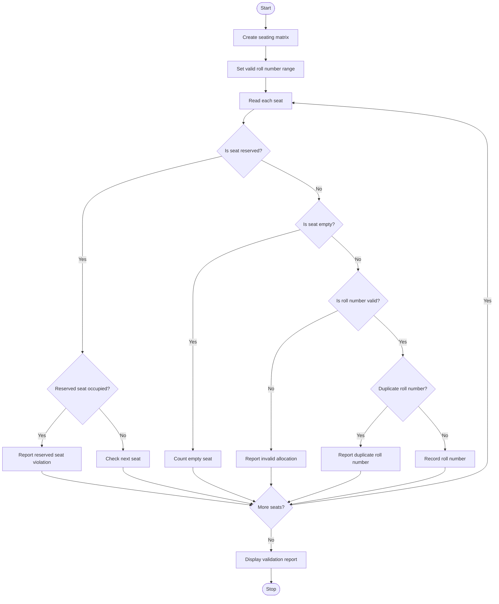

# 1. Problem Statement
Write a Python program using nested lists to validate an examination seating matrix. The program should identify duplicate roll numbers, reserved seats occupied by students, empty seats, and invalid student allocations. Finally, display the seating matrix and validation results.
# 2. Algorithm
1. Start the program.
2. Create a nested list representing the seating matrix.
3. Mark reserved seats using R and empty seats using 0.
4. Read the valid roll number range.
5. Traverse each seat in the matrix.
6. Check for duplicate roll numbers.
7. Check whether reserved seats are occupied.
8. Count empty seats and identify invalid roll numbers.
9. Display the matrix and validation report.
10. Stop the program.
# 3. Flowchart (Mermaid)

# 4. Source Code (Python)

rows = int(input("Enter rows: "))
cols = int(input("Enter columns: "))

seats = []
for i in range(rows):
    seats.append(input("Enter row: ").split())

seen = set()
duplicates = set()
empty = 0
invalid = []
reserved = []

print("\nSeating Matrix:")
for row in seats:
    print(*row)

for i in range(rows):
    for j in range(cols):
        seat = seats[i][j]

        if seat == "0":
            empty += 1
        elif seat == "R":
            continue
        else:
            if seat.startswith("R"):
                reserved.append((i + 1, j + 1, seat[1:]))
                continue

            if not seat.isdigit() or not 101 <= int(seat) <= 110:
                invalid.append(seat)
            elif seat in seen:
                duplicates.add(seat)
            else:
                seen.add(seat)

print("\nValidation Report")
print("Duplicate roll numbers:", sorted(duplicates))
print("Reserved seats occupied:", reserved)
print("Empty seats:", empty)
print("Invalid allocations:", invalid)
# 5. Sample Input
Enter rows: 3
Enter columns: 3
Enter row: 101 102 0
Enter row: 103 R 999
Enter row: 105 101 R106
# 6. Sample Output
Seating Matrix:
101 102 0
103 R 999
105 101 R106

Validation Report
Duplicate roll numbers: ['101']
Reserved seats occupied: [(3, 3, '106')]
Empty seats: 1
Invalid allocations: ['999']
# 7. Screenshot

