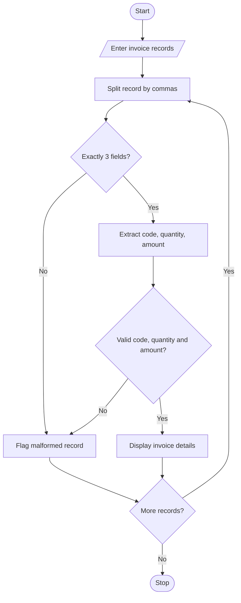

# 1. Problem Statement
Write a Python program to process formatted invoice strings using basic string operations. Extract the product code, quantity, and amount from each record. If a record is incorrectly formatted or contains invalid data, display it as a malformed record.
# 2. Algorithm
1. Start the program.
2. Read invoice records from the user.
3. Split each record using commas.
4. Check whether the record contains exactly three fields.
5. Extract the product code, quantity, and amount.
6. Validate the quantity and amount.
7. Display valid invoice details.
8. Flag invalid records as malformed.
9. Stop the program.
# 3. Flowchart (Mermaid)

# 4. Source Code (Python)

n = int(input("Enter number of records: "))

for i in range(n):
    record = input("Enter invoice (CODE,QTY,AMOUNT): ")
    data = record.split(",")

    try:
        if len(data) != 3:
            raise ValueError

        code = data[0].strip()
        qty = int(data[1])
        amount = float(data[2])

        if not code or qty <= 0 or amount < 0:
            raise ValueError

        print("Code:", code)
        print("Quantity:", qty)
        print("Amount: Rs.", amount)

    except ValueError:
        print("Malformed record:", record)
# 5. Sample Input
 Enter number of records: 3
Enter invoice (CODE,QTY,AMOUNT): P101,2,500
Enter invoice (CODE,QTY,AMOUNT): P102,3,750.50
Enter invoice (CODE,QTY,AMOUNT): P103,abc,200
# 6. Sample Output
Code: P101
Quantity: 2
Amount: Rs. 500.0

Code: P102
Quantity: 3
Amount: Rs. 750.5

Malformed record: P103,abc,200
# 7. Screenshot

