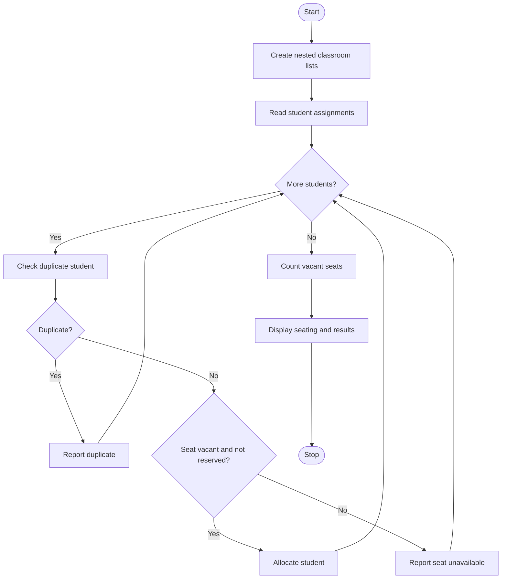

# 1. Problem Statement
Develop a Python program using nested lists to represent multiple classrooms and their seating positions. Allocate students to available seats, preserve reserved seats, detect duplicate student assignments, and calculate the total vacant seating capacity.
# 2. Algorithm
1. Start the program.
2. Create nested lists representing classrooms and seats.
3. Mark reserved seats using R and empty seats using 0.
4. Read student names and their seat assignments.
5. Allocate students only to available seats.
6. Check and report duplicate student assignments.
7. Count the vacant seats in all classrooms.
8. Display classroom seating, duplicate assignments, and vacant capacity.
9. Stop the program.
# 3. Flowchart (Mermaid)

# 4. Source Code (Python)

classrooms = [
    ["0", "R", "0"],
    ["0", "0", "R"]
]

assigned = set()

n = int(input("Number of students: "))

for i in range(n):
    name, c, s = input().split()
    c, s = int(c) - 1, int(s) - 1

    if name in assigned:
        print(name, "- Duplicate assignment")
    elif classrooms[c][s] != "0":
        print(name, "- Seat unavailable")
    else:
        classrooms[c][s] = name
        assigned.add(name)
        print(name, "- Seat allocated")

vacant = sum(row.count("0") for row in classrooms)

print("\nClassroom Seating:")
for i, room in enumerate(classrooms, 1):
    print("Classroom", i, ":", room)

print("Vacant seats:", vacant)
# 5. Sample Input
Number of students: 4
Ravi 1 1
Sita 1 3
Ravi 2 1
Kiran 2 2
# 6. Sample Output
Number of students: 4
Ravi - Seat allocated
Sita - Seat allocated
Ravi - Duplicate assignment
Kiran - Seat allocated

Classroom Seating:
Classroom 1 : ['Ravi', 'R', 'Sita']
Classroom 2 : ['0', 'Kiran', 'R']
Vacant seats: 1
# 7. Screenshot

