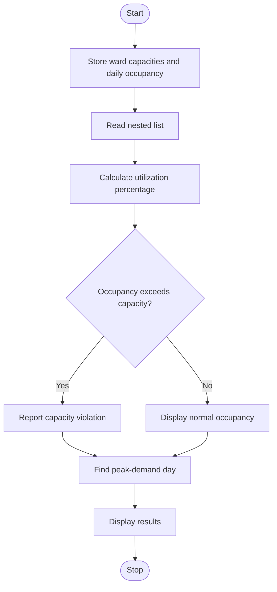

# 1. Problem Statement
Develop a Python program using a nested list to monitor hospital bed occupancy across different wards and days. Calculate bed utilization percentages, detect capacity violations when occupied beds exceed ward capacity, and identify the day with peak demand.
# 2. Algorithm
1. Start the program.
2. Store ward names, bed capacities, and daily occupancy counts.
3. Create a nested list to represent occupancy for each ward.
4. Calculate utilization percentage using:
\[
\text{Utilization}=\frac{\text{Occupied Beds}}{\text{Total Capacity}}\times100
\]

5. Check whether occupied beds exceed capacity.
6. Find the day with the highest occupancy.
7. Display utilization, capacity violations, and peak demand.
8. Stop the program.
# 3. Flowchart (Mermaid)

# 4. Source Code (Python)

wards = ["General", "ICU", "Pediatric"]
capacity = [20, 10, 15]
days = ["Monday", "Tuesday", "Wednesday"]

occupancy = [
    [15, 22, 18],
    [8, 10, 9],
    [12, 14, 16]
]

peak = 0

for i in range(len(wards)):
    print("\nWard:", wards[i])
    for j in range(len(days)):
        beds = occupancy[i][j]
        total = capacity[i]
        usage = beds / total * 100

        print(days[j], ":", beds, "beds, Utilization:",
              round(usage, 2), "%")

        if beds > total:
            print("CAPACITY VIOLATION!")

daily = [sum(occupancy[i][j] for i in range(len(wards)))
         for j in range(len(days))]

peak = daily.index(max(daily))
print("\nPeak Demand:", days[peak], "-", daily[peak], "beds")
# 5. Sample Input
Ward capacities:
General   : 20 beds
ICU       : 10 beds
Pediatric : 15 beds

Daily occupancy:
General   : [15, 22, 18]
ICU       : [8, 10, 9]
Pediatric : [12, 14, 16]
# 6. Sample Output
Ward: General
Monday : 15 beds, Utilization: 75.0 %
Tuesday : 22 beds, Utilization: 110.0 %
CAPACITY VIOLATION!
Wednesday : 18 beds, Utilization: 90.0 %

Ward: ICU
Monday : 8 beds, Utilization: 80.0 %
Tuesday : 10 beds, Utilization: 100.0 %
Wednesday : 9 beds, Utilization: 90.0 %

Ward: Pediatric
Monday : 12 beds, Utilization: 80.0 %
Tuesday : 14 beds, Utilization: 93.33 %
Wednesday : 16 beds, Utilization: 106.67 %
CAPACITY VIOLATION!

Peak Demand: Tuesday - 46 beds
# 7. Screenshot

