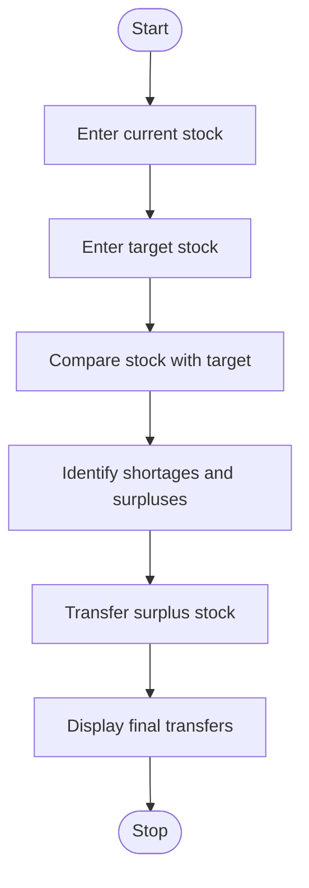

# 1. Problem Statement
To develop a Python program using nested lists to compare product quantities across warehouses. The program identifies shortages and surpluses, calculates the stock required to meet target quantities, and suggests transfers between warehouses.
# 2. Algorithm
1. Start the program.
2. Store current stock quantities in a nested list.
3. Store target stock quantities for each warehouse.
4. Compare current stock with target stock.
5. Identify surplus and shortage quantities.
6. Transfer surplus stock to warehouses with shortages.
7. Display shortages, surpluses, and required transfers.
8. Stop the program.
# 3. Flowchart (Mermaid)

# 4. Source Code (Python)

stock = [[50, 20], [10, 40]]
target = [[30, 30], [30, 30]]

surplus = []
shortage = []

for i in range(len(stock)):
    for j in range(len(stock[i])):
        diff = stock[i][j] - target[i][j]
        if diff > 0:
            surplus.append([i, j, diff])
        elif diff < 0:
            shortage.append([i, j, -diff])

print("Shortages and Surpluses:")
for i, j, q in surplus:
    print(f"Warehouse {i+1}, Product {j+1}: Surplus {q}")
for i, j, q in shortage:
    print(f"Warehouse {i+1}, Product {j+1}: Shortage {q}")

print("\nRequired Transfers:")
for s in surplus:
    for d in shortage:
        if s[1] == d[1] and s[2] > 0 and d[2] > 0:
            qty = min(s[2], d[2])
            print(f"Product {s[1]+1}: Warehouse {s[0]+1} "
                  f"to Warehouse {d[0]+1} = {qty}")
            s[2] -= qty
            d[2] -= qty
# 5. Sample Input
Current Stock:
[[50, 20],
 [10, 40]]

Target Stock:
[[30, 30],
 [30, 30]]
 # 6. Sample Output
 Shortages and Surpluses:
Warehouse 1, Product 1: Surplus 20
Warehouse 2, Product 2: Surplus 10
Warehouse 1, Product 2: Shortage 10
Warehouse 2, Product 1: Shortage 20

Required Transfers:
Product 1: Warehouse 1 to Warehouse 2 = 20
Product 2: Warehouse 2 to Warehouse 1 = 10
# 7. Screenshot

