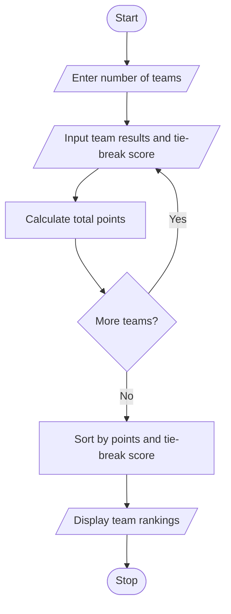

# 1. Problem Statement
Develop a Python program to store sports team match results, calculate total points, and rank teams based on competition rules. Each win earns 3 points, a draw earns 1 point, and a loss earns 0 points. If teams have equal points, the team with the higher tie-break score is ranked first.
# 2. Algorithm
1. Start the program.
2. Enter the number of teams.
3. Input each team's name, wins, draws, losses, and tie-break score.
4. Calculate total points using wins × 3 + draws.
5. Store team details in a dictionary.
6. Sort teams by total points and then tie-break score in descending order.
7. Display the final rankings.
8. Stop.
# 3. Flowchart (Mermaid)

# 4. Source Code
teams = {}
n = int(input("Enter number of teams: "))

for i in range(n):
    name = input("Team name: ")
    wins = int(input("Wins: "))
    draws = int(input("Draws: "))
    losses = int(input("Losses: "))
    tie = int(input("Tie-break score: "))

    points = wins * 3 + draws
    teams[name] = (points, tie)

ranking = sorted(
    teams.items(),
    key=lambda x: (x[1][0], x[1][1]),
    reverse=True
)

print("\nTournament Rankings")
for rank, (name, data) in enumerate(ranking, 1):
    print(rank, name, "Points:", data[0],
          "Tie-break:", data[1])
# 5. Sample Input
Enter number of teams: 4
Team name: Tigers
Wins: 3
Draws: 1
Losses: 0
Tie-break score: 12
Team name: Lions
Wins: 3
Draws: 1
Losses: 0
Tie-break score: 9
Team name: Eagles
Wins: 2
Draws: 1
Losses: 1
Tie-break score: 15
Team name: Hawks
Wins: 1
Draws: 1
Losses: 2
Tie-break score: 20
# 6. Sample Output
Tournament Rankings
1 Tigers Points: 10 Tie-break: 12
2 Lions Points: 10 Tie-break: 9
3 Eagles Points: 7 Tie-break: 15
4 Hawks Points: 4 Tie-break: 20
# 7. Screenshot

