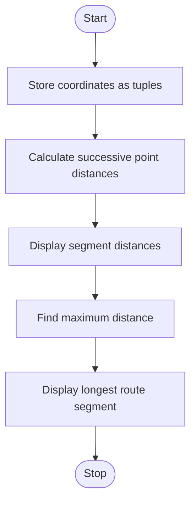

# 1. Problem Statement
Store geographical coordinates as tuples. Calculate the distances between successive points using the Euclidean distance formula and identify the longest route segment.
# 2. Algorithm
1. Start the program.
2. Store geographical points as tuples (x, y).
3. Calculate the distance between each pair of successive points using the formula:
\[
d=\sqrt{(x_2-x_1)^2+(y_2-y_1)^2}
\]

4. Display the distance of each route segment.
5. Identify the segment with the maximum distance.
6. Display the longest segment and its distance.
7. Stop the program.
# 3. Flowchart (Mermaid)

# 4. Source Code

import math

points = [(0, 0), (3, 4), (9, 4), (9, 12)]

distances = []

for i in range(len(points) - 1):
    x1, y1 = points[i]
    x2, y2 = points[i + 1]

    d = math.sqrt((x2 - x1)**2 + (y2 - y1)**2)
    distances.append(d)
    print(f"Segment {i + 1}: {d:.2f}")

longest = max(distances)
index = distances.index(longest)

print("Longest segment:", index + 1)
print(f"Longest distance: {longest:.2f}")
# 5. Sample Input
Points: (0, 0), (3, 4), (9, 4), (9, 12)
# 6. Sample Output
Segment 1: 5.00
Segment 2: 6.00
Segment 3: 8.00
Longest segment: 3
Longest distance: 8.00
# 7. Screenshot

