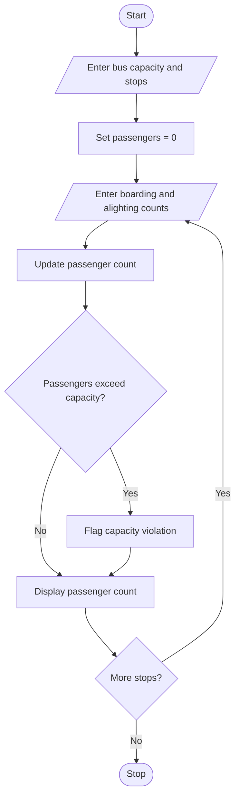

# 1. Problem Statement
Develop a Python program to simulate passenger boarding and alighting at multiple bus stops. Calculate the number of passengers after each stop and identify capacity violations when the passenger count exceeds the maximum bus capacity.
# 2. Algorithm
1. Start the program.
2. Read the bus capacity and number of stops.
3. Initialize the passenger count to zero.
4. For each stop, read the number of boarding and alighting passengers.
5. Calculate the updated passenger count.
6. Check whether the passenger count exceeds the bus capacity.
7. Display the passenger count and flag any capacity violation.
8. Repeat for all stops.
9. Stop the program.
# 3. Flowchart (Mermaid)

# 4. Source Code (Python)

capacity = int(input("Enter bus capacity: "))
stops = int(input("Enter number of stops: "))

passengers = 0

for i in range(1, stops + 1):
    print("\nStop", i)
    boarding = int(input("Boarding passengers: "))
    alighting = int(input("Alighting passengers: "))

    passengers = passengers - alighting + boarding

    print("Passengers:", passengers)

    if passengers > capacity:
        print("Capacity Violation!")
    else:
        print("Within Capacity")
# 5. Sample Input
Enter bus capacity: 10
Enter number of stops: 3

Stop 1
Boarding passengers: 6
Alighting passengers: 0

Stop 2
Boarding passengers: 5
Alighting passengers: 2

Stop 3
Boarding passengers: 4
Alighting passengers: 1
# 6. Sample Output
Stop 1
Passengers: 6
Within Capacity

Stop 2
Passengers: 9
Within Capacity

Stop 3
Passengers: 12
Capacity Violation!
# 7. Screenshot

